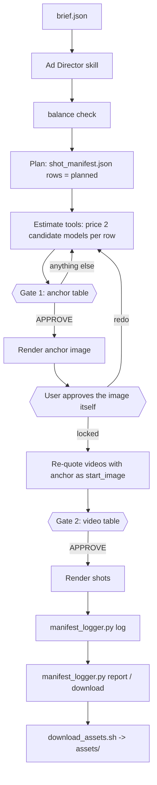

# higgsfield-director-os

An automated **Product-to-Ad and Multi-Shot Storyboard Orchestrator** for [Claude](https://claude.ai) +
[Higgsfield](https://higgsfield.ai). You give it a product brief; Claude directs the shoot as a budget-aware
production pipeline with three guarantees:

1. **Estimate-Before-Render.** No credit is spent until you have seen the exact model, resolution, duration
   and price, and typed `APPROVE`.
2. **Anchor-First Continuity.** One approved hero image is generated first and reused as the start frame of
   every video shot, so the product never drifts.
3. **Manifest Logging.** Every asset is recorded in a validated JSON manifest (job id, model, estimated and
   actual credits, hosted URL), and a generated script archives the files locally before hosted URLs expire.

It was built to run on a tiny free-trial balance, which makes the gates the point of the project.

## Architecture



## Repository layout

```
.claude/skills/ad-director/SKILL.md   Skill: the three rules + workflow
schemas/campaign_brief.schema.json    Input schema (what the human writes)
schemas/shot_manifest.schema.json     Output schema (what the pipeline records)
scripts/manifest_logger.py            Validate, approve, log, budget report, archive script
examples/eclipse-ronin/                Demo campaign: brief.json + shot_manifest.json
assets/                               Local archive of rendered files (git-ignored by default; see below)
```

## Credit-gating design rationale

Generative video is priced per request, and prices vary by more than an order of magnitude between models
and modes. In the demo run, the same 5-second vertical shot quoted at 2.5, 5, 7.5 and 15 credits depending
on model and resolution. A pipeline that picks a model silently can burn a whole trial in one call.

The design choices that follow from that:

- **Price first, from the platform.** Cost comes from Higgsfield's estimate tools, never from the model's
  memory. Quotes return a `quote_ref`, and the render is submitted with that ref so what is paid for is
  exactly what was approved.
- **Approval is a literal token.** `APPROVE` cannot be confused with casual agreement, and it is scoped
  to the rows in the table shown. Any change to the request requires a new quote and a new approval.
- **Gates are enforced in code too.** `manifest_logger.py approve` refuses rows with no estimate, refuses a
  video whose anchor is not completed and approved, and refuses approvals that would exceed the cap.
  `validate` flags any manifest row that is rendered without approval.
- **Anchor before motion.** Still images are the cheapest asset, so identity is settled there. Video models
  then animate a fixed image instead of reinventing the product each time, which also removes the most
  common reason to pay for a re-render.
- **Failures are not retried blindly.** After a timeout the outcome is unknown; the skill checks the balance
  and job list before anything is resubmitted.

## Setup

### 1. Connect Higgsfield MCP

- **Claude (web, desktop, mobile):** add Higgsfield from the connectors directory, or add the custom
  connector URL `https://mcp.higgsfield.ai/mcp` under Settings -> Connectors, then sign in to your
  Higgsfield account.
- **Claude Code:** `claude mcp add --transport http higgsfield https://mcp.higgsfield.ai/mcp`, then
  authenticate when prompted (check `claude mcp --help` if flags change between versions).

### 2. Install the skill

Clone this repo and open it in Claude Code; the skill in `.claude/skills/ad-director/` is picked up
automatically. In other Claude surfaces, upload the `ad-director` folder as a skill.

### 3. Python tooling (optional but recommended)

```bash
python3 -m venv .venv && source .venv/bin/activate
pip install jsonschema        # full schema validation; the script degrades gracefully without it
```

## Usage

```bash
# Validate the example manifest (schema + credit-gate + anchor-first rules)
python scripts/manifest_logger.py validate --manifest examples/eclipse-ronin/shot_manifest.json

# Budget report: spent vs cap
python scripts/manifest_logger.py report --manifest examples/eclipse-ronin/shot_manifest.json

# After the user replies APPROVE for a row
python scripts/manifest_logger.py approve --manifest examples/eclipse-ronin/shot_manifest.json --shot-id asset_0_anchor

# After the render finishes
python scripts/manifest_logger.py log --manifest examples/eclipse-ronin/shot_manifest.json \
  --shot-id asset_0_anchor --status completed --job-id <JOB_ID> --hosted-url <HTTPS_URL> \
  --balance-before 10 --balance-after 9.25

# Archive hosted assets locally
python scripts/manifest_logger.py download --manifest examples/eclipse-ronin/shot_manifest.json \
  --output download_assets.sh --write-local-paths
bash download_assets.sh
```

Then ask Claude: *"Use the ad-director skill to run `examples/eclipse-ronin/brief.json`."*

Exit codes: `0` ok, `1` validation errors, `2` over budget.

Note: in the claude.ai chat, Claude works in a sandbox and cannot write directly to your local folder. It
hands you the files, and you run `download_assets.sh` yourself. In Claude Code it can edit the repo directly.

## Demo campaign: ECLIPSE RONIN

A 9:16 dark-fantasy anime teaser: one locked anchor image (lone swordsman on a rainy midnight rooftop)
and three 5-second shots (push-in, detail pan, crane pull-back), capped at 10 credits.

### Pre-render quotes (Higgsfield estimate tools)

| Row | Model | Res / AR | Duration | Credits if paid | Free unlimited? |
|-----|-------|----------|----------|-----------------|-----------------|
| Anchor image | `gpt_image_2_6` (medium) | 1k / 9:16 | n/a | 1 | Yes |
| Anchor image | `soul_cinematic` | n/a | n/a | not quoted | No |
| Video shot (x3) | `seedance_2_5` omni_reference | 720p / 9:16 | 5 s | 35 each | Yes |
| Video shot (x3) | `seedance_2_0_mini` | 480p / 9:16 | 5 s | 2.5 each | No |

Video quotes are provisional until the locked anchor is attached.

### Benchmark (fill in after the run)

| Metric | Estimate | Actual |
|--------|----------|--------|
| Anchor image credits | _TBD_ | _TBD_ |
| Video shot credits | _TBD_ | _TBD_ |
| Total credits vs 10-credit cap | _TBD_ | _TBD_ |
| Anchor generation time | n/a | _TBD_ |
| Video generation time | n/a | _TBD_ |
| Anchor re-rolls needed | n/a | _TBD_ |
| Identity drift (1-5, human rating) | n/a | _TBD_ |

## Archiving and git

Rendered media can be large. Either commit selected assets deliberately, or add `assets/*` (keeping
`assets/.gitkeep`) to `.gitignore` and keep `shot_manifest.json` as the committed record.

## License

Choose a license before publishing (MIT is a common default for tooling like this).
